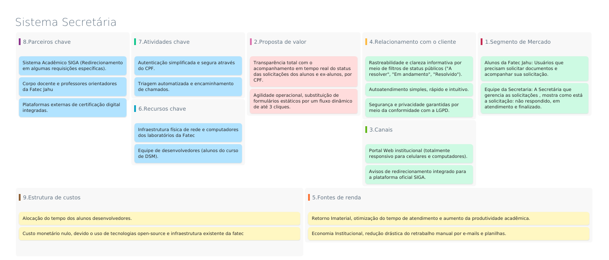

**CENTRO PAULA SOUZA**

**FACULDADE DE TECNOLOGIA DE JAHU**

**CURSO DE TECNOLOGIA EM DESENVOLVIMENTO DE SOFTWARE MULTIPLATAFORMA**

# DOCUMENTO DA APLICAÇÃO WEB

## Auxílio aos Problemas da Secretária

Daniel Augusto Melo

Daniel Borges De Oliveira

Maxwell da Silva Costa

Michel Moraes Luz da Silva

Tiago Miranda dos Santos

**Jahu, SP**

**1º semestre/2026**

---

## SUMÁRIO

1. RESUMO DA APLICAÇÃO WEB
   - 1.1 Objetivos
   - 1.2 MÉTODOS DA PESQUISA
2. DOCUMENTO DE REQUISITOS
   - 2.1 REQUISITOS FUNCIONAIS
     - 2.1.1 Grupo de RF 1
     - 2.1.2 Grupo de RF 2
     - 2.1.3 Grupo de RF 3
   - 2.2 REQUISITOS NÃO FUNCIONAIS
     - 2.2.1 Requisito de produto
     - 2.2.2 Requisito de Organização
     - 2.2.3 Requisitos de Confiabilidade
     - 2.2.4 Requisito de Implantação
     - 2.2.5 Requisito de Padrões
     - 2.2.6 Requisitos de Interoperabilidade
   - 2.3 DIAGRAMA DE CASOS DE USO
   - 2.4 DIAGRAMA DE CLASSES
3. REGRAS DE NEGÓCIO
4. ESTUDO DE VIABILIDADE
5. MODELO DE DADOS
6. DESIGN
7. PROTÓTIPO
8. APLICAÇÃO
9. BANCO DE DADOS
10. CONSIDERAÇÕES FINAIS

REFERÊNCIAS BIBLIOGRÁFICAS

---

# 1 RESUMO DA APLICAÇÃO WEB

O projeto a ser desenvolvido tem como finalidade facilitar o dia a dia da secretária, pois existe uma demanda de problemas que poderia ser resolvidas diretamente pelo sistema, que além de deixar automatizado e organizado, facilita do que apenas deixar documentos em Forms e procurar por e-mails.

## 1.1 OBJETIVOS

Temos como objetivos a criação de um sistema, que possa praticamente resolver toda a demanda da secretária de forma digitalizada e estruturada, com foco na facilidade da comunicação entre alunos e a secretária. Pois com essa facilitação, o resultado pode chegar mais rápido e modernizar grande parte dos processos.

## 1.2 MÉTODOS DA PESQUISA

Os nossos métodos para realização desse projeto, é usando o que temos no momento, avaliando a forma de trabalho da secretária, as dificuldades dos alunos quanto aos aplicativos que atualmente são utilizados e a forma de solicitação de documentos, que atualmente é por Forms, whatsapp, siga e e-mail. Então com as ferramentas que já são utilizadas apenas nos cabe uma junção das solicitações dentro de um sistema.

Portanto através desse nosso sistema web, o aluno passará conseguir solicitar, anexar e terá acesso a prazos de documentação. E a secretária com uma melhor gestão de solução de problemas e facilitando o envio das solicitações, entre outras coisas que fazem parte do dia a dia.

# 2 DOCUMENTO DE REQUISITOS

Quando se é falamos em requisitos de um sistema automaticamente o que vem em mente é o processo de estabelecer as funções e restrições que o sistema deve possuir, com base na solicitação do cliente.

Então a documentação de requisitos se trata das descrições, detalhes do projeto, deixando claro o que será implantado.

## 2.1 REQUISITOS FUNCIONAIS

O sistema de secretaria deve permitir que o aluno registre demandas, acesse a plataforma informando seu CPF e visualize o andamento do atendimento em tempo real por meio de status (como 'em andamento' ou 'finalizado'), garantindo um canal direto de comunicação entre o aluno e a secretaria

Interface do Sistema para os Alunos

**RF 1 - Autenticar por CPF:**

O sistema deve permitir que o aluno acesse a plataforma informando exclusivamente o seu número de CPF.

**RF 2 – Exibir Menu de Solicitações:**

O sistema deve exibir um menu digital interativo substituindo os formulários antigos por botões de requisição direta, com atributos: emissão certificados, emissão atestado etc.

**RF 3 – Emitir Alerta de Solicitações Externas:** O sistema deve exibir uma mensagem de aviso e um link de redirecionamento para a plataforma SIGA quando o aluno tentar solicitar um documento específico que não seja gerido pela secretaria.

2.1.2 Mostrar interface do Sistema da Secretária

**RF 4 - Expor painel de gestão de ocorrências:** O sistema deve disponibilizar uma tela para a secretaria gerenciar os protocolos através de filtros de status (*A resolver*, *em andamento*, *Resolvidos*).

**RF 5 – Atualizar status:** A secretaria deve ser capaz de alterar o status das ocorrências dos alunos.

**RF 6 - Armazenar links de certificação:** O sistema deve permitir que a secretaria cadastre e armazene links de certificação digital atrelados aos documentos gerados.

## 2.2 REQUISITOS NÃO FUNCIONAIS

Os requisitos não funcionais focam na qualidade do nosso sistema, ou seja, o desempenho, segurança, responsividade e usabilidade.

### 2.2.1 • Requisitos de Produto

**RNF 1 - Responsividade (Aluno):** A interface do aluno deve ser totalmente responsiva, adaptando-se a dispositivos móveis e desktops.

**RNF 2 - Otimização Desktop (Secretaria):** A interface da secretaria deve ser otimizada para telas desktop, priorizando a visualização de painéis e tabelas de protocolos.

**RNF 3 - Usabilidade e Simplicidade:** O sistema deve substituir os antigos formulários (*Forms*) por um fluxo dinâmico, permitindo a abertura de uma solicitação com no máximo 3 cliques.

### 2.2.2 • Requisitos de Organização

**RNF 4 - Entrega e Validação Incremental:** A interface do aluno deve ser prototipação, testada e homologada antes da liberação final do módulo de atendimento da secretaria.

### 2.2.3 • Requisitos de Confiabilidade

**RNF 7 - Preservação de Dados (Backup):** O armazenamento dos links de certificação digital e o histórico de status dos protocolos devem possuir rotinas automatizadas de backup diário para evitar a perda de informações.

### 2.2.4 • Requisitos de Implementação

**RNF 9 - Tecnologia Web:** O sistema deve ser desenvolvido utilizando tecnologias web modernas que permitam a execução direta no navegador, sem a necessidade de instalação de softwares locais nas máquinas da secretaria.

**RNF 10 - Arquitetura Leve:** A aplicação deve ser implementada de modo a consumir o mínimo de banda de internet.

### 2.2.5 • Requisitos de Padrões

**RNF 11 - Padrão de Acesso Simplificado:** O acesso do aluno deve seguir estritamente o padrão de identificação única via campo de **CPF**, sem a exigência de criação de senhas complexas nesta primeira fase.

**RNF 12 - Conformidade com a LGPD:** O tratamento do CPF e dos dados de ocorrências dos alunos deve seguir rigorosamente os padrões legais da Lei Geral de Proteção de Dados (Lei nº 13.709).

**RNF 13 - Identidade Visual:** O sistema deve seguir o padrão visual e de cores.

### 2.2.6 • Requisitos de Interoperabilidade

**RNF 14 - Redirecionamento para o SIGA:** O sistema deve ser capaz de identificar solicitações restritas e realizar o direcionamento externo (links/avisos) de forma integrada e funcional para a plataforma SIGA.

**RNF 15 - Integração de Certificação Digital:** O campo de armazenamento da secretaria deve ser compatível com links gerados por plataformas externas de certificação digital reconhecidas.

## 2.3 DIAGRAMA DE CASOS DE USO

## 2.4 DIAGRAMA DE CLASSES

# 3 REGRAS DE NEGÓCIO

Para nossa regra de negócios utilizamos Business Model Canvas que é uma ferramenta de gestão estratégica que permite esboçar e estruturar o modelo de funcionamento de um projeto através de 9 blocos fundamentais. No contexto deste projeto, estabelece as diretrizes operacionais para transformar a gestão manual da secretaria em um fluxo digital.

Para melhor entendimento dos blocos da imagem está um resumo e como cada um desses 9 blocos se encaixa no nosso sistema da secretária:

**1. Segmento de Mercado**

Define os diferentes grupos de pessoas ou organizações que a aplicação visa atender e gerar valor.

No nosso projeto ele concentra-se nos Alunos da Fatec Jahu, que necessitam de um canal ágil para solicitar documentos e acompanhar prazos, e na Equipe da Secretaria, que demanda um painel gerencial para monitorar solicitações através de atualizações de status (não respondido, em atendimento e finalizado).

**2. Proposta de Valor**

O conjunto de produtos, serviços e diferenciais que criam valor para um segmento de cliente específico, resolvendo um problema ou satisfazendo uma necessidade.

Projetamos para que oferecesse transparência total aos estudantes por meio do acompanhamento em tempo real das solicitações via CPF, além de promover agilidade operacional ao substituir formulários estáticos e fragmentados por um fluxo de atendimento dinâmico resolvido em até 3 cliques.

**3. Canais**

Descreve como a aplicação se comunica e alcança seus segmentos de clientes para entregar sua proposta de valor.

Centralizado em um Portal Web institucional, com interface totalmente responsiva adaptada para celulares e computadores, operando também como um indexador de avisos e links de redirecionamento integrado para a plataforma oficial SIGA.

**4. Relacionamento com o Cliente**

Estabelece o tipo de relação e as estratégias de interação que a aplicação mantém com cada segmento de cliente.

Baseia-se no autoatendimento simples, rápido e intuitivo, proporcionando clareza informativa com o uso de filtros de status públicos ("A resolver", "Em andamento", "Resolvido") e garantindo a privacidade dos dados sob estrita conformidade com a LGPD.

**5. Fontes de Renda**

Representa a forma como o projeto gera valor, receita ou retornos justificáveis para a organização que o mantém.

Para esse sistema o retorno imaterial, focado na otimização do tempo de atendimento e no aumento da produtividade acadêmica, gerando uma significativa economia institucional pela redução drástica do retrabalho manual com e-mails e planilhas.

**6. Recursos Chave**

Os ativos e meios mais importantes exigidos para fazer o modelo de negócios funcionar e viabilizar a proposta de valor.

No nosso sistema consiste na infraestrutura física de rede e computadores dos laboratórios da Fatec Jahu e na força de trabalho da equipe de desenvolvedores, ou seja os alunos do curso de DSM.

**7. Atividades Chave**

As ações e rotinas mais cruciais que a equipe e o sistema devem executar frequentemente para manter a operação ativa.

O sistema contempla os processos de autenticação simplificada e segura através do CPF, a triagem automatizada para o encaminhamento interno de chamados, o cadastro e armazenamento de links de certificação digital e a execução de backups diários automáticos.

**8. Parceiros Chave**

A rede de fornecedores, aliados e agentes externos que contribuem para a otimização, redução de riscos ou expansão dos recursos do projeto.

Nesse caso envolve o Sistema Acadêmico SIGA (essencial para o redirecionamento de requisições específicas), o suporte consultivo do corpo docente e professores orientadores da instituição, e as plataformas externas de certificação digital integradas.

**9. Estrutura de Custos**

Descreve todos os custos operacionais, financeiros e de recursos direcionados para a construção e manutenção do modelo de negócios.

Neste caso configura-se com custo monetário nulo, em decorrência do aproveitamento de tecnologias open-source e da infraestrutura computacional já existente na fatec, somado ao investimento de horas através da alocação do tempo letivo dos alunos desenvolvedores.

# 4 ESTUDO DE VIABILIDADE

**4.1 Viabilidade Técnica**

A viabilidade técnica é sustentada pelas competências práticas desenvolvidas nas disciplinas de Engenharia de Software, Desenvolvimento Web e Design Digital. Tecnicamente, o desafio consiste em centralizar os fluxos fragmentados (atualmente distribuídos em Microsoft Forms, WhatsApp, SIGA e e-mail) em uma plataforma única. O sistema utilizará tecnologia web acessível para implementar o mecanismo de autenticação por CPF, o upload de anexos e o motor de atualização de status em tempo real ('em andamento' ou 'finalizado'). A infraestrutura física e de rede necessária para o desenvolvimento é integralmente fornecida pelos laboratórios da Fatec.

**4.2 Viabilidade Financeira**

O projeto apresenta custo financeiro direto nulo, visto que toda a infraestrutura de hardware, conectividade e ferramentas de desenvolvimento já estão disponíveis na instituição. A substituição das ferramentas gratuitas e descentralizadas (como Forms e e-mails manuais) por um sistema web customizado não gerará custos de licenciamento. O investimento resume-se à mão de obra de nós alunos, cujo cronograma está dimensionado para o período letivo. O retorno financeiro indireto se dará pela redução do tempo de atendimento e otimização da força de trabalho da secretaria, além do ganho de produtividade acadêmica para os alunos, gerando valor imaterial para a instituição.

**4.3 Viabilidade de Mercado**

Por se tratar de um software sob medida para uso interno, a viabilidade de mercado avalia o impacto da solução frente às alternativas atuais. O sistema proposto valida-se ao solucionar a ineficiência da pulverização de canais, unificando as interações em um ambiente digital estruturado. O mercado-alvo (composto pelo corpo discente e pela equipe administrativa da Fatec) apresenta alta receptividade, pois a solução elimina processos manuais e resolve diretamente a dificuldade dos alunos no acompanhamento de prazos e na solicitação de documentos, estabelecendo um padrão de modernização institucional.

**4.4 Viabilidade Operacional**

A viabilidade operacional é alta, pois o sistema foi desenhado com base em um método de pesquisa que avaliou a rotina real da secretaria e as dores dos alunos. A transição para o novo sistema será natural, pois a secretaria passará a gerir todas as demandas em uma única tela de controle, facilitando o envio de respostas. Para os alunos, a usabilidade baseada em Design Digital garantirá que o ato de solicitar documentos, anexar arquivos e consultar prazos seja simples e intuitivo. O apoio consultivo dos professores garante a qualidade do deploy, e a facilidade operacional do software assegura que ele será plenamente adotado no dia a dia da secretaria.

# 5 MODELO DE DADOS

- Modelo conceitual
- Modelo lógico
- Físico

# 6 DESIGN

- Paleta de cor
- Tipografia
- Logo
- Wireframe
- Modelo de navegação

# 7 PROTÓTIPO

Gere um protótipo functional na ferramenta que se sentir mais confortável (Figma, por exemplo) e apresente aqui, indicando o link.

# 8 APLICAÇÃO

Apresente o processo de desenvolvimento, as etapas, algumas telas da Aplicação, atualizadas agora com Banco de Dados.

# 9 BANCO DE DADOS

(MODELO CONCEITUAL)

# 10 CONSIDERAÇÕES FINAIS

Faça uma breve contextualização do processo de desenvolvimento da Aplicação, comente sobre limitações, dificuldades enfrentadas, contribuições da Aplicação etc.

# REFERÊNCIAS BIBLIOGRÁFICAS
